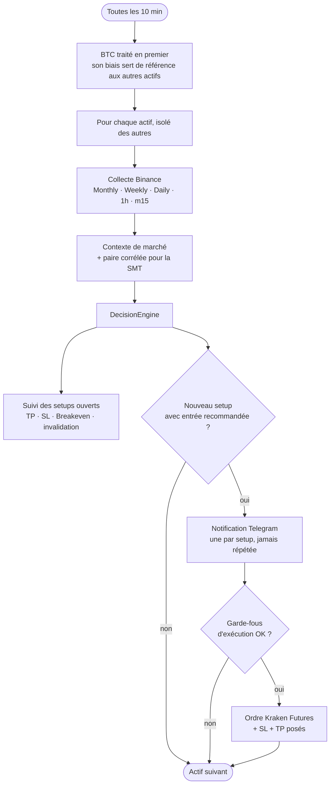
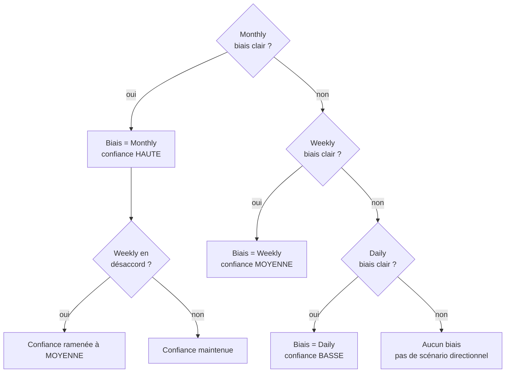
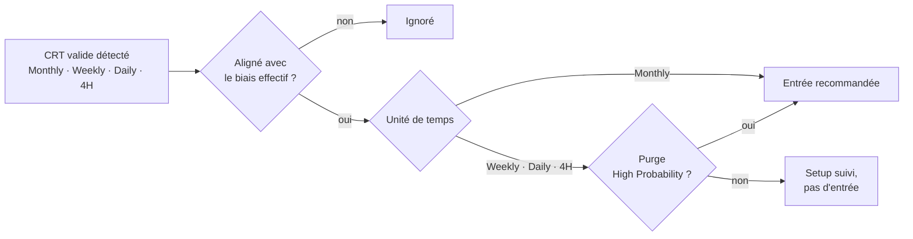
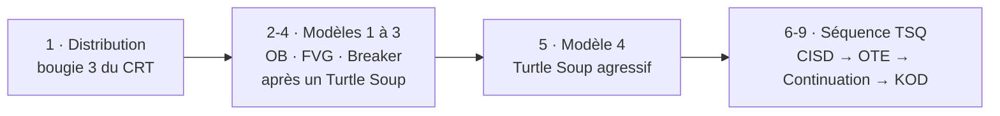
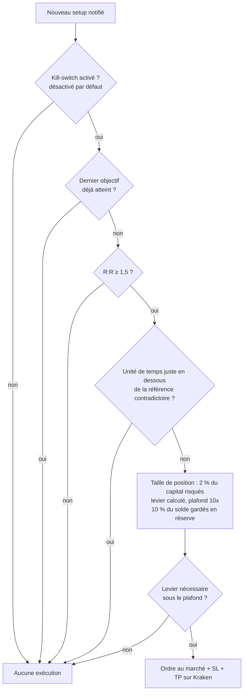
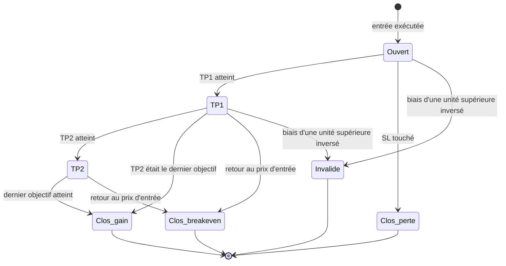

# CRTxICT Crypto — État du projet et fonctionnement de la stratégie

*Mise à jour : 21 octobre 2026*

Ce document décrit **ce que fait le robot aujourd'hui** et **comment il
décide** : de la lecture du marché jusqu'à la gestion d'une position.
Pour l'installation et l'utilisation, voir le [README](README.md).

---

## 1. Périmètre actuel

| Élément | État actuel |
|---|---|
| Marché | Crypto uniquement, contrats perpétuels **Binance Futures USDⓈ-M** |
| Actifs suivis | BTC, ETH, ADA, TRX, BNB, DOT, SUI (`config/alerts.yaml`) |
| Données | Binance, endpoints publics (aucune clé requise) |
| Exécution | **Un seul compte** : le vôtre, sur **Kraken Futures** |
| Notifications | Telegram (signaux de trading + messages d'administration) |
| Fréquence | Un cycle complet toutes les **10 minutes** (`poll_interval_minutes`) |
| Intelligence artificielle | **Aucune** : toute la décision et tout le message sont déterministes |
| Déploiement | Docker (ARM64 pour Raspberry Pi, x86_64 pour le cloud) |

**Retiré du projet** (version précédente) : gestion de comptes tiers et
facturation, exécution IBKR, OKX et Binance, actifs Forex/CFD/Futures.
`collectors/polygon.py` reste disponible pour un usage futur, mais
aucun actif n'y est configuré.

---

## 2. Vue d'ensemble d'un cycle



Un échec sur un actif (donnée manquante, erreur réseau) n'empêche
jamais le traitement des autres.

---

## 3. La stratégie, étape par étape

La méthode est **fractale** : les mêmes concepts s'appliquent du
Monthly jusqu'au m15. Le robot lit d'abord la direction de fond sur les
grandes unités de temps, cherche ensuite un setup CRT aligné avec cette
direction, puis affine l'entrée sur les petites unités de temps.

### 3.1 Le pattern CRT (Candle Range Theory)

Un CRT se forme quand une bougie **ancre** définit une fourchette, que
le prix y reste contenu, puis qu'une bougie **purge** la liquidité d'un
côté (sa mèche dépasse l'extrême de l'ancre) sans clôturer en dehors.
Le marché est alors censé aller chercher l'extrême **opposé** : c'est la
**DOL** (Draw on Liquidity).

```
Exemple haussier (purge côté bas)

   High de l'ancre ─────────────────────────────  ← TP2 = DOL (100 %)
         │  ┃                                        objectif principal
         │  ┃ Ancre      Bougie(s) contenue(s)
   Milieu ─ ┃ ─ ─ ─ ─ ─ ─ ─ ─ ─ ─ ─ ─ ─ ─ ─ ─ ─  ← TP1 = 50 % du range
         │  ┃                 ┃
   Low de l'ancre ──────────────┃───────────────
                                ╽  ← mèche de purge sous le Low,
                                     clôture revenue dans la fourchette
                                     SL = Low de cette bougie de purge
```

Pour un CRT baissier, c'est le symétrique : purge au-dessus du High,
DOL au Low, SL au High de la bougie de purge.

**Objectifs d'un setup** (`rules/decision_engine.py::_compute_crt_targets`) :

| Niveau | Calcul |
|---|---|
| TP1 | 50 % du range de l'ancre |
| TP2 | Extrême opposé de l'ancre (la DOL du CRT) |
| TP3 | DOL d'une unité de temps **supérieure**, si elle est plus loin dans le même sens et à moins de 50 % du prix actuel |
| SL | High/Low de la bougie de purge |

**Filtres anti-obsolescence** (`rules/crt_rule.py`) : un CRT est écarté
si sa cible est déjà atteinte, si son SL est déjà franchi, si l'ancre est
à plus de 50 % du prix actuel, ou si elle est trop ancienne :

| Unité de temps | Âge maximum de l'ancre |
|---|---|
| Monthly | 12 bougies |
| Weekly | 26 bougies |
| Daily | 60 bougies |
| 4H | 60 bougies |

### 3.2 Le biais directionnel : une cascade du haut vers le bas

Le robot détermine **une seule direction de travail** (le *biais
effectif*) en partant de la plus grande unité de temps. Il ne descend
d'un niveau que si celui du dessus n'offre rien de clair, et la
confiance baisse à chaque descente.



**À chaque unité de temps, qu'est-ce qu'un « biais clair » ?**
(`rules/decision_engine.py::_resolve_timeframe_bias`)

1. **Un CRT valide** : priorité absolue, son sens donne le biais.
2. **À défaut, une cassure de biais** : la dernière bougie **clôturée**
   ferme au-delà de la mèche de la précédente. Le robot remonte
   l'historique pour retrouver la cassure la plus récente qui n'a pas
   été invalidée. Seule la clôture d'une bougie ultérieure peut
   l'invalider, jamais le prix en temps réel.
3. **La double purge** (une bougie dont le High *et* le Low ont été
   balayés) sert de confirmation, pas de vote autonome.

**Renforcement de la confiance** : une prise de liquidité Weekly dans le
sens du biais valide le scénario et peut remonter la confiance de
moyenne à haute.

### 3.3 Les setups : un CRT par unité de temps

Le robot cherche un CRT sur **Monthly, Weekly, Daily et 4H**. Chaque CRT
valide **et aligné avec le biais effectif** devient un setup
indépendant, avec un nom stable (ex. `BTC Weekly CRT (28/06)`) qui le
suit dans toutes ses notifications. Un CRT dans le sens opposé est
ignoré.



**La purge est-elle de « haute probabilité » ?** (`rules/purge_rule.py`)
Le critère dépend de l'unité de temps du CRT (heures exprimées en heure
de New York) :

| CRT | Critère de timing de la purge |
|---|---|
| Weekly | La purge a lieu la semaine qui suit l'ancre (semaine 1 → semaine 2) |
| Daily | Ancre le lundi → purge mardi ou mercredi ; ancre le vendredi → purge le lundi |
| 4H | Ancre 14h → purge vers 2h ; 18h → 6h ; 22h → 10h (tolérance 1 h) |

Deux confirmations complémentaires sont aussi relevées, sans être
bloquantes : la **KillZone** (Londres 2h-5h, New York 7h-10h) et les
**Algo Times** (fenêtres de 20 minutes entre 8h20 et 11h40).

### 3.4 L'entrée précise

Une fois qu'un setup recommande une entrée, le robot cherche sur
l'intraday un point d'entrée plus fin. **Une seule entrée est retenue**,
la première trouvée dans cet ordre (`rules/refined_entry.py`), et
seulement si elle va dans le sens du biais :



- **Turtle Soup** (`rules/entry_rule.py`) : le prix balaie un pool de
  liquidité (plus haut/bas de la veille, de la session asiatique) puis
  clôture de l'autre côté, en confluence avec un Key Level et du bon
  côté du *True Day Open* (minuit, heure de New York).
- **Séquence TSQ** (`rules/tsq_rule.py`) : changement de délivrance
  (CISD, clôture au-delà de l'open de la jambe opposée), retracement dans
  la zone OTE (62 %-79 % de Fibonacci), reprise du mouvement
  (Continuation), ou piège à grand corps (KOD).

Par défaut, l'exécution se fait **au marché** avec le SL et les TP du
CRT. L'entrée précise est notifiée une seule fois, pour aider à
l'exécution manuelle. Cas particulier : si un setup Weekly a déjà
atteint son TP1 au moment où il est détecté, l'exécution est
**différée** jusqu'à ce qu'une entrée TSQ apparaisse.

### 3.5 Le contexte, purement informatif

Ces éléments apparaissent dans la notification mais **ne modifient
jamais** la décision ni la confiance :

- **Biais de BTC**, affiché sur tous les autres actifs, pour repérer un
  trade à contre-courant du marché.
- **SMT** (divergence Smart Money) entre l'actif et sa paire corrélée
  (BTC↔ETH fixé, les autres paires trouvées automatiquement au-delà
  d'une corrélation de 0,7).
- **Narrative** : profils hebdomadaires et intraday, dealing range,
  Key Levels proches.
- **Calendrier économique** : les news à haut impact sont signalées ;
  l'entrée reste notifiée, avec un avertissement de volatilité.

---

## 4. De la décision à la position : les garde-fous

Une notification n'entraîne une exécution réelle que si **toutes** ces
conditions sont réunies (`main.py::dispatch_alert`) :



- **Kill-switch** (`execution/kill_switch.py`) : désactivé par défaut,
  et tout état illisible est traité comme désactivé. L'activation
  demande de taper `ACTIVER` ; la désactivation est immédiate.
- **Coordination des unités de temps** : si la référence est le Monthly
  et que le Weekly la contredit franchement (ou Weekly contredit par
  Daily), il y a trop d'incertitude. La notification part, mais aucune
  position n'est prise. Une unité de temps sans biais ne bloque jamais.
- **Clés API sans droit de retrait** : le robot peut trader, jamais
  déplacer les fonds.

Les valeurs (2 %, 1,5, 10x, 10 %) se règlent dans
`config/alerts.yaml::execution`.

---

## 5. Cycle de vie d'un trade



- **Un TP intermédiaire ne clôture pas le trade** : le setup reste suivi
  jusqu'au dernier objectif disponible ou jusqu'au stop.
- **Breakeven** : dès TP1, le stop est réellement déplacé au prix
  d'entrée sur l'exchange. Un retour à ce niveau clôture à zéro, ce qui
  est notifié comme un Breakeven, distinct d'une perte.
- **Invalidation** : si une unité de temps supérieure bascule dans le
  sens opposé (ex. un setup Weekly baissier alors que le Monthly devient
  haussier), le trade est clôturé sans attendre le stop.

**Résilience** (vérifications à chaque cycle) :

| Situation | Réaction |
|---|---|
| Setup notifié mais jamais exécuté (kill-switch activé après coup, panne) | Exécution de rattrapage, sauf si le prix a déjà dépassé le SL ou si le R:R n'est plus suffisant |
| Position ouverte sans SL ou TP actifs | Réparation automatique + message d'administration |
| Échec du déplacement du SL au Breakeven | Nouvel essai à chaque cycle + alerte Telegram |
| Échec d'une clôture | Alerte Telegram immédiate : vérification manuelle requise |
| Clé API révoquée ou invalide | Alerte unique, puis message de rétablissement |

---

## 6. Organisation du code

| Dossier | Contenu |
|---|---|
| `collectors/` | `binance.py` (actif), `macro.py` (calendrier SoSoValue, optionnel), `polygon.py` (disponible, inactif) |
| `models/` | Bougies, séries, données de marché, événements macro |
| `rules/` | `crt_rule`, `dol_rule`, `keylevel_rule`, `narrative_rule`, `narrative_ltf_rule`, `purge_rule`, `entry_rule`, `tsq_rule`, `refined_entry`, `correlation`, et l'orchestrateur `decision_engine` |
| `messaging/` | `formatter.py` : construction déterministe des messages Telegram, calcul du R:R |
| `database/` | `db.py` : SQLite (décisions, alertes, déduplication, suivi TP/SL/Breakeven) |
| `notifications/` | `telegram_sender.py` |
| `execution/` | Kill-switch, interface `ExchangeClient`, client Kraken Futures, dimensionnement, registres d'ordres persistants, santé des clés API, messages d'administration |
| `backtest/` | Simulateurs, coûts d'exécution, Monte Carlo, rapports |
| `tests/` | Suite `pytest` (180 tests) |
| `tools/` | `prepublish_check.py` : contrôle avant publication |

**Scripts à la racine** : `main.py` (robot, `--once` pour un seul
cycle), `manage_execution.py` (kill-switch), `check_kraken_connection.py`
(test des clés sans passer d'ordre), `preview_notifications.py` et
`preview_admin_notifications.py` (aperçu des messages),
`reset_alerts.py`, `reset_logs.py`, `run_backtest.py`,
`run_backtest_intraday.py`, `monte_carlo.py`.

---

## 7. Backtest

| Outil | Ce qu'il fait |
|---|---|
| `run_backtest.py` | Backtest historique simple : biais + cibles CRT au pas journalier |
| `run_backtest_intraday.py` | Rejoue le **vrai** `DecisionEngine` à chaque bougie m15, sans accès aux données futures, puis enchaîne un backtest **réaliste** : frais (~0,05 % par jambe), slippage (5 pb), filtre R:R, levier et capital qui évolue trade après trade |
| `monte_carlo.py` | Ré-échantillonne les résultats réalistes (bootstrap) : distribution du rendement, du drawdown maximum et probabilité de ruine |

**Résultat de référence (BTC, 1 an)** : +6,63 R cumulés avant coûts,
mais portés presque entièrement par 2 trades exceptionnels ; sans eux,
l'année aurait été négative (-8,06 R). C'est précisément ce que la
simulation Monte Carlo sert à mesurer.

**Hors périmètre du backtest** : la ré-entrée TSQ différée des setups
Weekly et le filtre de coordination des unités de temps (§ 4) ne sont
pas encore simulés.

---

## 8. Limites connues et pistes

- [ ] Revalider l'exécution Kraken Futures avec de petites quantités
  (ou l'environnement démo) après la simplification de l'architecture.
- [ ] Le filtre de coordination ne couvre que Monthly→Weekly et
  Weekly→Daily : aucun biais n'est calculé au niveau 4H.
- [ ] La précision du « moment de la purge » (KillZone, Algo Times) est
  bornée par la granularité des données intraday.
- [ ] Ajouter au backtest la ré-entrée TSQ et le filtre de coordination.
- [ ] Le calcul du R:R se fait depuis le prix actuel : un prix très
  proche du SL fait tendre le ratio vers l'infini (le filtre ne protège
  que contre un R:R trop faible).
