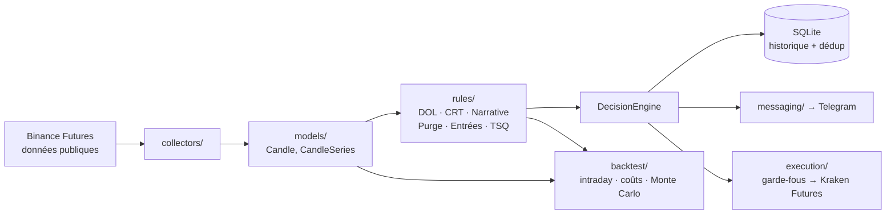

# CRTxICT Crypto


Moteur d'analyse et d'exécution de trading crypto, **100 % déterministe**
(aucune IA dans le pipeline), fondé sur la méthodologie **CRT** (Candle
Range Theory) et les concepts **ICT** (liquidité, Draw on Liquidity, FVG,
Order Blocks, Turtle Soup, killzones).

Le robot analyse 7 contrats perpétuels Binance (BTC, ETH, ADA, TRX, BNB,
DOT, SUI) en multi-timeframe (Monthly → Weekly → Daily → 4H → m15),
envoie des notifications Telegram structurées et peut exécuter les
setups validés sur Kraken Futures, avec un ensemble de garde-fous de
gestion du risque.

> ⚠️ Projet personnel à but éducatif et démonstratif. Ce n'est **pas** un
> conseil en investissement. Le trading à effet de levier peut entraîner
> la perte totale du capital.

> 🧪 **Statut : projet de recherche, non exploité en continu.** Les
> résultats mesurés sont trop irréguliers pour une utilisation en
> production. Voir [Objectif et conclusion](#objectif-et-conclusion).

---

## Objectif et conclusion

**Objectif** : tester rigoureusement une stratégie de trading
discrétionnaire populaire (CRT et concepts ICT), souvent présentée comme
« rentable ». La méthode a été entièrement codée en règles
déterministes, puis évaluée avec des coûts réels (frais, slippage,
levier) et une simulation Monte Carlo.

**Conclusion : aucun edge mesurable.** Sur BTC, une année de backtest
réaliste n'est positive que grâce à deux trades exceptionnels ; sans
eux, l'année est perdante. L'observation en conditions réelles va dans
le même sens : les gains relèvent de la chance et de la tendance de fond
du marché.

Ce constat a mené au projet suivant, [**NewsRadar_MSSE**](https://github.com/Lxboi/NewsRadar_MSSE),
qui cherche où un véritable edge pourrait se trouver.

---

## Points clés

- **Moteur de règles modulaire** : chaque règle (`rules/`) suit le même
  contrat `BaseRule.evaluate(context, config) -> RuleResult`, testée
  isolément.
- **Cascade de biais multi-timeframe** : Monthly → Weekly → Daily, avec
  priorité CRT valide > cassure de biais (double purge en confirmation), et une
  confiance réduite à chaque descente.
- **Setups CRT nommés et suivis** de la détection jusqu'au dernier
  objectif (TP progressifs, mécanique de Breakeven, invalidation par
  contradiction de biais HTF).
- **Exécution automatique sécurisée** : kill-switch persistant
  (désactivé par défaut, fail-safe), filtre R:R minimum, plafond de
  levier, position sizing au % de risque, clés API sans permission de
  retrait, retry et alertes en cas d'échec d'ouverture, de clôture ou de
  déplacement du stop.
- **Backtest réaliste** : rejoue le *vrai* `DecisionEngine` bougie m15
  par bougie m15 (anti-lookahead strict), applique frais, slippage et
  levier réels, puis une simulation **Monte Carlo** (bootstrap) pour
  estimer la distribution des rendements, du drawdown et la
  probabilité de ruine.
- **Qualité** : 180+ tests `pytest`, intégration continue GitHub
  Actions, scan de secrets automatique.

## Architecture



Le fonctionnement détaillé (cascade de biais, setups CRT, entrées,
garde-fous, cycle de vie d'un trade, organisation du code) est décrit
avec des schémas dans [`PROJECT_STATUS.md`](PROJECT_STATUS.md).

## Démarrage rapide

```bash
git clone https://github.com/Lxboi/CRTxICT_Crypto.git
cd CRTxICT_Crypto
python -m venv .venv
source .venv/bin/activate        # Windows : .venv\Scripts\activate
pip install -e ".[dev]"           # dépendances + outils de test (pyproject.toml)

cp .env.example .env             # puis renseignez vos propres clés
python -m pytest -q              # lance la suite de tests
python main.py --once            # un cycle complet d'analyse
```

L'exécution réelle reste **désactivée** tant que le kill-switch n'est
pas activé explicitement (`python manage_execution.py --enable`).

### Docker / Raspberry Pi

```bash
docker compose up -d --build
docker compose logs -f trading-alert-bot
```

Image `python:3.12-slim` multi-architecture (ARM64 et x86_64). Base de
données, logs et état d'exécution sont montés en volumes.

## Backtest

```bash
# Backtest intraday + backtest réaliste (frais, slippage, levier)
python run_backtest_intraday.py --source binance --symbol BTC --years 1

# Monte Carlo sur le résultat réaliste
python monte_carlo.py --input backtest_realistic_BTC_1y.csv --n-simulations 10000
```

## Configuration

- `config/alerts.yaml` : seuils des règles, actifs suivis, paramètres
  d'exécution (risque par trade, R:R minimum, levier max).
- `.env` : secrets (Telegram, Kraken, clés optionnelles) — voir
  [`.env.example`](.env.example). Jamais versionné.

## Stack

Python 3.12 · pydantic · APScheduler · SQLite · python-telegram-bot ·
loguru · pytest · Docker · GitHub Actions

## Auteur

**Enzo-LIBOÏ** — [LinkedIn](https://www.linkedin.com/in/enzo-libo%C3%AF/) · [GitHub](https://github.com/Lxboi)
